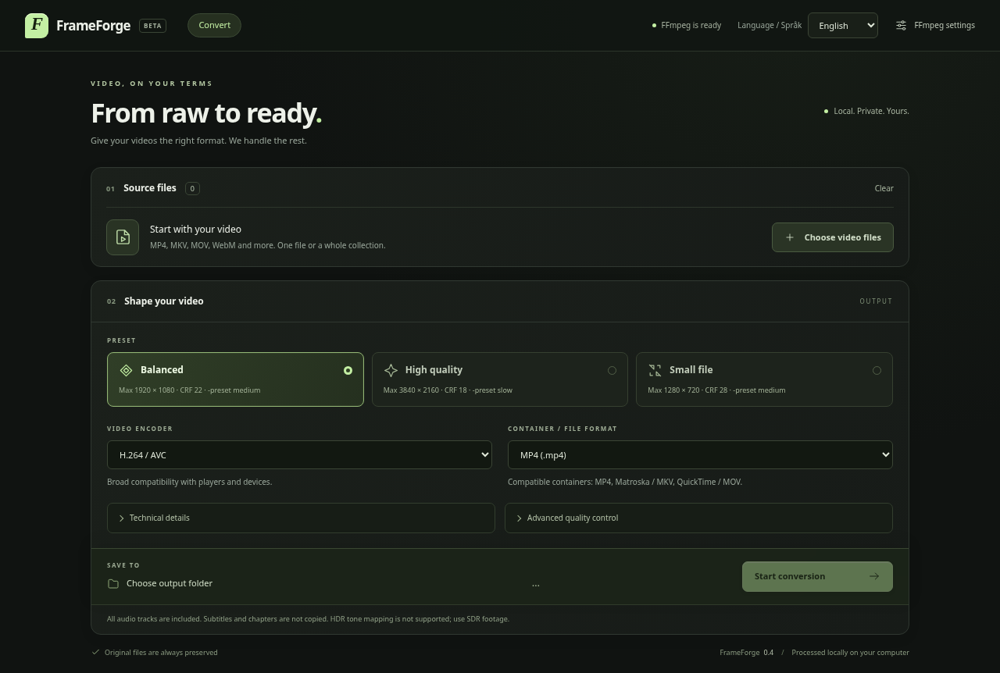

# FrameForge

En första Windows-app för lokal videokonvertering, byggd med Electron och FFmpeg. Svenskt och engelskt gränssnitt, filkö, tre kvalitetsprofiler, H.264/H.265/AV1/VP9, fyra containrar och avbrytning. Originalfiler och befintliga utdatafiler skrivs inte över.

Detta är en tidig version, inte full funktionsparitet med HandBrake. Undertexter, GPU-kodning, videoförhandsvisning, kapitel och avancerat spårval finns ännu inte. FFmpeg körs på CPU. Alla ljudspår inkluderas som AAC (MP4/MKV/MOV) eller Opus (WebM). HDR konverteras inte med tonmappning; använd SDR-källor tills HDR-stöd finns.

## Utveckling på Windows

1. Installera Node.js 24 LTS. FFmpeg kan hämtas direkt från appen eller installeras manuellt.
2. Kör `npm ci` i projektmappen.
3. Kör `npm start`. Om FFmpeg saknas visas **Ladda ned FFmpeg**. Klicka för att hämta, verifiera och installera det automatiskt. Du kan också välja en egen `ffmpeg.exe` via **FFmpeg-inställningar**.
4. Lägg till videor och välj kvalitetsprofil, kodare och container. Klicka **Starta konvertering**. Om ingen utdatamapp är vald öppnas mappdialogen automatiskt; konverteringen startar efter valet. Avbryts dialogen ligger kön kvar utan att starta. En redan vald mapp återanvänds.

Filer bearbetas sekventiellt. Avbrutna och misslyckade jobb raderar sin ofullständiga utdatafil. Appen väljer ett ledigt filnamn automatiskt. Kö och utdatamapp sparas inte mellan starter; FFmpeg-sökvägen sparas i användarens appdata. Språk väljs via **Språk / Language** i toppraden och sparas lokalt mellan starter.

## Verifiering

`npm test` testar också FFmpeg-installation med ett lokalt ZIP-testpaket: nedladdning, SHA-256, uppackning, misslyckad verifiering och nätverksfel. Windows-binärens start verifieras vid installation på Windows. Videotesterna kräver en redan installerad FFmpeg/ffprobe.

`npm test` skapar en kort syntetisk video och verifierar riktig kodning och avkodning för alla elva tillåtna kombinationer av kodare/container, både CRF och målbitrate, ljudspår, skalning av stående video, filskydd och avbrytning med FFmpeg/ffprobe på PATH. `FFMPEG_PATH` och `FFPROBE_PATH` kan ange andra körbara filer för testerna.

## Windows-installationsfil

Kör `npm run dist:win` på Windows. Installationsfilen skapas under `dist/`. Byggkommandot använder `--publish never`: ingen GitHub-release publiceras och ingen `GH_TOKEN` behövs. Actions bifogar installationsfilen som en nedladdningsbar artifact. Den är osignerad tills ett kodsigneringscertifikat konfigureras. En Windows-runner för manuell byggning finns i GitHub Actions. Certifikat och FFmpeg ingår inte i distributionen.

## Säkerhetsmodell

Renderaren saknar Node-åtkomst och kör med isolerad kontext och sandbox. Filåtkomst väljs genom operativsystemets dialoger. FFmpeg startas utan kommandoskal. Inga molntjänster eller API-nycklar krävs.

## Automatisk FFmpeg-installation (Windows)

Knappen hämtar `ffmpeg-master-latest-win64-gpl.zip` och `checksums.sha256` via HTTPS från [BtbN/FFmpeg-Builds](https://github.com/BtbN/FFmpeg-Builds), en Windows-byggleverantör länkad på FFmpegs nedladdningssida. SHA-256 måste matcha innan arkivet packas upp eller någon binär startas. Därefter kontrolleras `ffmpeg.exe -version`. Paketets medföljande licensfiler behålls. Det är en separat tredjepartsnedladdning, inte en del av FrameForge-installationsfilen.

FFmpeg sparas under användarens appdata för FrameForge (`tools/ffmpeg-install-*`), utan administratörsrättigheter eller ändringar av PATH. Appen sparar sökvägen automatiskt. Internet och tillgång till github.com samt release-assets.githubusercontent.com krävs. Vid fel raderas den ofullständiga installationen och tidigare FFmpeg-inställning bevaras. Appen visar nedladdade MB och procent när servern anger storlek. Automatisk uppdatering av FFmpeg ingår inte.

## Kvalitet, bitrate och format (0.3)

Varje profil visar sin upplösningsgräns, CRF eller målbitrate och FFmpegs hastighetsparameter för den valda kodaren. **Tekniska detaljer** visar även kodarbibliotek, ljudbitrate, pixel-/färgformat och bildfrekvens. Renderaren och kommandobyggaren använder samma inställningskälla (`src/formats.js`).

| Profil | Maximal bildruta | H.264 CRF / preset | H.265 CRF / preset | AV1 CRF / preset | VP9 CRF / cpu-used |
| --- | --- | --- | --- | --- | --- |
| Balanserad | 1920 × 1080 | 22 / medium | 24 / medium | 32 / 8 | 32 / 4 |
| Hög kvalitet | 3840 × 2160 | 18 / slow | 20 / slow | 24 / 6 | 24 / 2 |
| Liten fil | 1280 × 720 | 28 / medium | 30 / medium | 40 / 10 | 40 / 5 |

H.264 använder libx264, H.265 libx265, AV1 libsvtav1 och VP9 libvpx-vp9 (`-deadline good`). Bilden ryms i profilens maximala bredd **och** höjd, med bibehållet bildförhållande och utan uppskalning. Alla använder 8-bit yuv420p och CPU-kodning. Ingen bildfrekvens anges manuellt. MP4/MOV får faststart; HEVC i dessa containrar märks med hvc1.

CRF är konstant kvalitet med variabel bitrate. Värdet går inte att jämföra direkt mellan olika kodekar och innebär inte en bestämd bitrate eller filstorlek. Under **Avancerad kvalitetsstyrning** kan användaren i stället välja målbitrate, 100–200 000 kbit/s, i ett VBR-pass. Då används inte CRF; profilens upplösningsgräns och hastighet gäller fortfarande. Målbitrate är inte en garanti för faktisk eller maximal bitrate och inkluderar inte ljudet.

| Container | Tillåtna videokodekar | Ljud per spår |
| --- | --- | --- |
| MP4 | H.264, H.265, AV1 | AAC 192 kbit/s |
| MKV | H.264, H.265, AV1, VP9 | AAC 192 kbit/s |
| WebM | AV1, VP9 | Opus 128 kbit/s |
| MOV | H.264, H.265 | AAC 192 kbit/s |

Byte till en inkompatibel kombination justerar automatiskt det andra valet och visar vad som ändrades. Kodare som saknas i den valda FFmpeg-installationen inaktiveras. Stöd i en container innebär inte att varje spelare eller enhet kan avkoda videon.

Svenska och engelska omfattar profiler, tekniska förklaringar, status, knapptexter och appens vanliga felmeddelanden. FFmpegs egna tekniska felutskrifter behåller originalspråket. Native fildialogers standardknappar följer operativsystemets språk.

## Fönster och layout (0.3.1)

Startfönstret anpassas till skärmens tillgängliga arbetsyta, även vid Windows-skärmskalning. Smalare fönster använder en kolumn och inställningarna följer vanlig sidrullning i stället för en höjdbegränsad inre panel. Startåtgärderna följer med längst ned i den synliga inställningspanelen. Inställningar kan nås utan att förstora fönstret.

## Kompakt gränssnitt (0.4)

En smal topprad samlar språk och FFmpeg-inställningar. Källfiler väljs i en kompakt horisontell yta; filkön har egen rullning efter flera filer. Kvalitetsprofilerna ligger sida vid sida, liksom kodek/container och de utfällbara tekniska inställningarna. Utdatamapp och konverteringsknapp delar en åtgärdsrad som följer med vid rullning. På små fönster staplas kontrollerna utan att döljas. SVG-ikoner medföljer appen och kräver inga nätverkstjänster.
